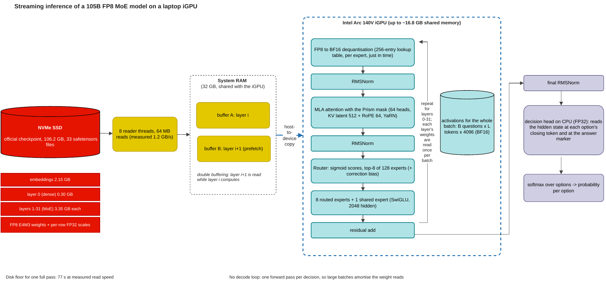
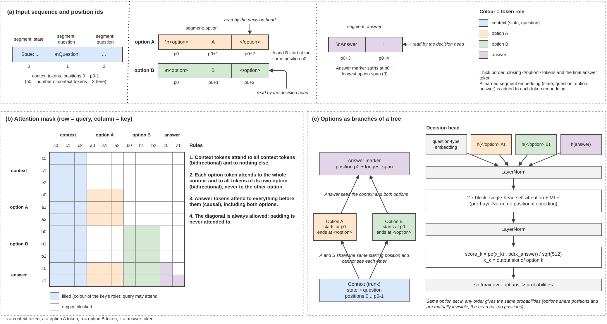
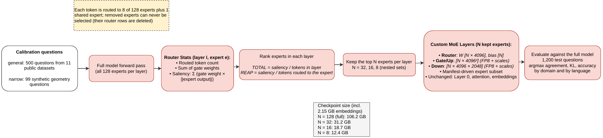
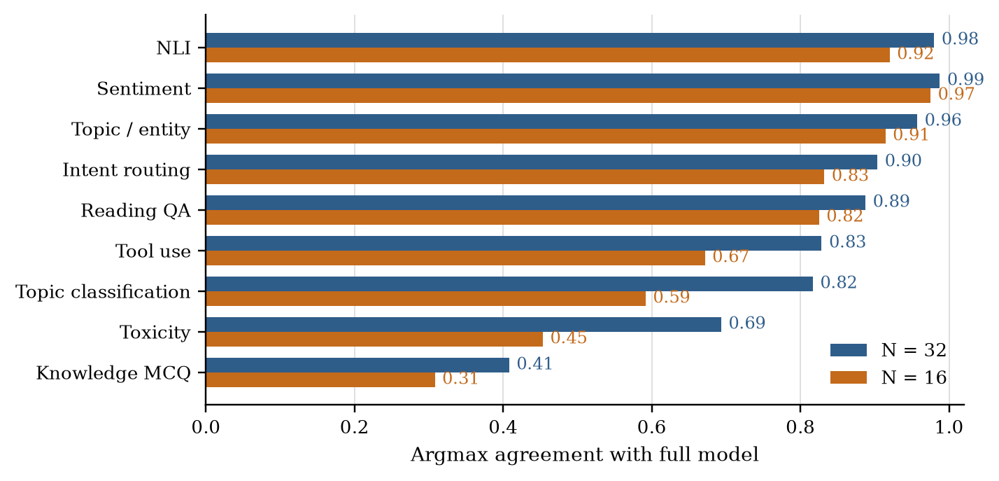

# Prismlet

**Running a 105B FP8 mixture-of-experts decision model on a laptop GPU, and measuring how much of it can be removed.**

[Paper (PDF)](paper/prismlet_report.pdf) · [Project page](https://prnvkk.github.io/Prismlet/) · [Model: sarvamai/prism](https://huggingface.co/sarvamai/prism) · Apache 2.0

[Prism](https://huggingface.co/sarvamai/prism) is Sarvam's decision model. It reads a request and returns a probability for every option of every question in a single forward pass. Its weights are 106 GB of FP8, and the reference code expects a datacentre GPU. This repository contains:

- **A streaming engine** in pure PyTorch. It runs the full model on an Intel Arc 140V integrated GPU with 32 GB of shared RAM, reading one decoder layer at a time from an NVMe SSD.
- **An expert-pruning study.** It keeps N of the 128 routed experts per layer and measures what breaks.

No weights are released. The pruned variants did not hold up well enough (see below).

## How it works

<p align="center"></p>

A generative model reads every layer once per generated token. A decision model has no decode loop, so each layer is read once per *batch*. While the GPU computes layer *i*, a background reader fills a second buffer with layer *i+1*. FP8 weights are dequantised to BF16 with a 256-entry lookup table, one expert at a time. Larger batches spread the 77.2 s disk read over more questions.

<p align="center"></p>

The engine reproduces Prism's input layout:
- The context is bidirectional.
- Options share start positions and cannot see each other.
- The answer marker attends to everything before it.
- A small attention head scores each option's closing token against the answer token.

## Results

| | |
|---|---|
| Layer check against an FP32 CPU reference | 0 failures |
| Model card example | same answers on all three questions; max probability gap 0.041383 |
| Agreement with the hosted Sarvam API (1,200 questions) | 0.9267, mean KL 0.0474 |
| Accuracy: engine vs hosted API | 0.8192 vs 0.8175 |
| Throughput, full model, batch 64 | 32.0 tokens/s |

**Pruning.** Experts are ranked by router saliency on a calibration set; the top N per layer are kept:

<p align="center"></p>

Keeping 32 of 128 experts gives 0.7750 overall agreement with the full model. The loss is uneven:
- NLI, sentiment and intent routing survive.
- Knowledge multiple choice and Hindi, Bengali and Telugu do not.

<p align="center"></p>

The calibration set matters more than the ranking rule. Experts chosen on synthetic geometry questions agree 0.9683 on held-out geometry questions, but only 0.6508 on the general test set. The paper has the per-language results, the calibration cross-check and the layer-skip ablation.

## Quick start

```bash
pip install -r requirements.txt          # torch 2.9.1+xpu; CPU also works
huggingface-cli download sarvamai/prism --local-dir weights   # ~106 GB
```

```python
from prismlet import PrismEngine

engine = PrismEngine(weights_dir="weights", device="xpu")   # or "cpu"
print(engine.decide(
    {"ticket": "My card was charged twice and I still haven't got a refund."},
    {"team": {"type": "choice",
              "instructions": "Which team should handle this ticket?",
              "criteria": {"billing": "payments and refunds",
                           "tech": "app or website problems",
                           "delivery": "shipping and order status"}},
     "urgent": {"type": "yes_no", "instructions": "Does this need a reply within the hour?"}},
))
```

To check the engine against the model card example:

```bash
python scripts/golden.py --weights weights
```

Each file in [`results/`](results/) lists the script and command that produced it in [`results/README.md`](results/README.md). Tests run with `pytest`, and the weight-dependent tests run with `pytest --weights=weights`.

## Repository layout

```
prismlet/      engine: streaming loader, FP8 dequant, MLA attention, MoE, decision head, pruning
reference/     independent FP32 CPU reference used by the tests
scripts/       one script per experiment
results/       every number in the paper, as JSON/CSV
paper/         LaTeX source and PDF
calibration/   synthetic geometry question generator
tests/         CPU tests, plus weight-dependent tests behind --weights
```

## Limitations

- **Speed.** A full pass takes minutes, not milliseconds. The SSD alone sets a 77.2 s floor.
- **Precision.** The engine computes in BF16. Optional FP8 activation emulation brings it closer to the published numbers.
- **Hardware.** Tested on one Intel laptop. Not tested on NVIDIA GPUs.
- **Data licences.** Question text from CC-BY-SA datasets is not redistributed; result files carry ids, labels and probabilities only.

## Citation

```bibtex
@misc{krishnakumar2026prismlet,
  title  = {Prism on a Laptop: Streaming Inference of a 105B FP8
            Mixture-of-Experts Decision Model and a Study of Expert Pruning},
  author = {Krishnakumar, Pranav},
  year   = {2026},
  note   = {Technical report},
  url    = {https://prnvkk.github.io/Prismlet/}
}
```

## License

Apache 2.0. The input encoding, attention mask, decision head and rotary tables follow the official [`sarvamai/prism`](https://huggingface.co/sarvamai/prism) implementation (Apache 2.0); see [`NOTICE`](NOTICE). This is an unofficial project, not affiliated with or endorsed by Sarvam AI.
